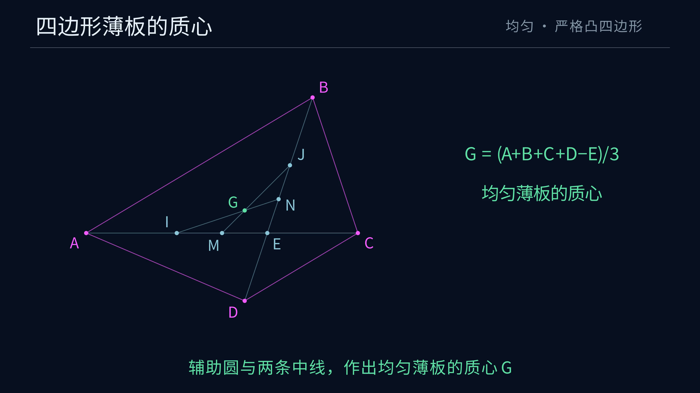

# Euclid-Quadrilateral-Centroid · 四边形薄板的质心

**给定凸四边形，用无刻度直尺和圆规，构造均匀薄板的质心。**

本项目是 Euclid 几何研究系列的第九题，重点为一般证明、完整作图步骤与 Manim 动画。保留题集中的辅助圆作法，补齐对角线被平分时的特殊分支。

[观看 4K60 动画](https://raw.githubusercontent.com/lenovobenben/euclid-quadrilateral-centroid/main/animations/centroid/media/QuadrilateralCentroid_4k60.mp4) · [完整作图步骤](docs/ANSWER.md) · [一般证明](docs/PROOF.md) · [题面与工具](docs/DESIGN.md)

[](https://raw.githubusercontent.com/lenovobenben/euclid-quadrilateral-centroid/main/animations/centroid/media/QuadrilateralCentroid_4k60.mp4)

*动画 65.7 秒，3840 × 2160、60 fps，展示构造、面积加权证明及特殊情形。*

## 题目与结论

给定按边界顺序排列的严格凸四边形 $ABCD$。记 $E$ 为对角线交点，$M,N$ 分别为 $AC,BD$ 的中点。均匀薄板的质心为

$$\boxed{G=\frac{A+B+C+D-E}{3}=\frac{2M+2N-E}{3}.}$$

令 $V$ 为 $MN$ 的中点，即四顶点的等权平均点，则

$$V=\frac{A+B+C+D}{4},\qquad \overrightarrow{VG}=\frac13\overrightarrow{EV}.$$

非平行四边形中，$E,V,G$ 依次共线，$EV:VG=3:1$。平行四边形中三点重合。[面积加权推导与一般证明](docs/PROOF.md)

## 作图主线

当 $M,N$ 均与 $E$ 不同时，使用原题的辅助圆。

1. 作两条对角线的垂直平分线，交于 $F$。
2. 以 $F$ 为圆心、经过 $E$ 作圆。
3. 取圆与 $AC,BD$ 除 $E$ 以外的交点 $I,J$。
4. 连接 $NI,MJ$，交于所求质心 $G$。

圆心在弦的垂直平分线上，所以 $M,N$ 分别为 $EI,EJ$ 的中点。两条连接线恰为三角形 $EIJ$ 的两条中线，它们的交点满足

$$G=\frac{E+I+J}{3}=\frac{2M+2N-E}{3}.$$

薄板质心公式由沿 $AC$ 分割后的两个三角形按面积加权得到。[逐步作法](docs/ANSWER.md) · [构造正确性](docs/PROOF.md)

## 特殊情形

| 输入关系 | 作法 |
|---|---|
| $M\ne E,\ N\ne E$ | 辅助圆与两条中线 |
| $M=E,\ N\ne E$ | 在 $EN$ 上取 $EG=\tfrac23 EN$ |
| $N=E,\ M\ne E$ | 在 $EM$ 上取 $EG=\tfrac23 EM$ |
| $M=N=E$ | 平行四边形，输出 $G=E$ |

恰有一条对角线被平分时，原辅助圆与该对角线相切，两条连接线重合。两条对角线互相平分时，辅助圆半径为零。完整答案展开三等分分支及所用尺规宏，覆盖全部严格凸输入。[分支与宏](docs/ANSWER.md)

## 动画

沿用系列的深蓝背景、中文说明和细线几何。洋红表示给定对象，金色表示当前动作，淡蓝表示辅助对象，绿色表示结果。

动画依次展示对角线、中点与中垂线、辅助圆、两个交点及最后的两条连接线。证明段展示两个三角形的面积加权，再放大辅助三角形说明中线关系。随后展示 $E,V,G$ 的比例及特殊分支。[分镜与复现](animations/centroid/README.md)

## 精确核验与复现

SageMath 10.7 精确核验通过 3 项一般多项式恒等式、361 次构造重放与 5 项非法输入检查。四种作图分支均有覆盖，包括顺逆时针编号、循环换名、旋转、反射、平移、缩放、垂直对角线、无理代数坐标及 $10^{-100}$ 级邻近特殊输入。

核验器将实际圆交点或三等分作图结果，与多边形边界一阶矩公式独立比较。一般证明见 [PROOF](docs/PROOF.md)，实际核验记录随 [geometry.json](animations/centroid/geometry.json) 保存。

在项目根目录执行

```powershell
docker run --rm --network none -e PYTHONDONTWRITEBYTECODE=1 -e OPENBLAS_NUM_THREADS=1 -v "${PWD}:/workspace" -w /workspace sagemath/sagemath@sha256:4f5589eb6c565949a006f8665de2876b8414410daf5ac554f4434a15d4f3d528 sage -python animations/centroid/export_geometry.py
```

## 文档入口

| 内容 | 文件 |
|---|---|
| 给定信息、质心定义与尺规工具 | [DESIGN](docs/DESIGN.md) |
| 完整作图、特殊分支、尺规宏与精确案例 | [ANSWER](docs/ANSWER.md) |
| 面积加权、辅助圆、中线与有限性证明 | [PROOF](docs/PROOF.md) |
| 动画、精确数据、显示回归与渲染 | [动画目录](animations/centroid/README.md) |

## 来源与项目定位

题目及辅助圆作法由作者在 `ai-math-notes` 原始问答中给出。本项目按《Euclid 十题研究路线图》第九题整理证明、特殊分支、完整作图及动画。原问答、路线图与相关文献入口统一记录于证明末节。[原题与来源](docs/PROOF.md#9-来源与整理范围)

**Euclid 几何研究系列**

[Euclid-Min](https://github.com/lenovobenben/euclid-min) · [Euclid-CCC-Min](https://github.com/lenovobenben/euclid-ccc-min) · [Euclid-Equal-Angle-Min](https://github.com/lenovobenben/euclid-equal-angle-min) · [Euclid-Castillon-Min](https://github.com/lenovobenben/euclid-castillon-min) · [Euclid-Conic-Classification](https://github.com/lenovobenben/euclid-conic-classification) · [Euclid-Cubic-Trisection](https://github.com/lenovobenben/euclid-cubic-trisection) · [Euclid-Square-Reconstruction](https://github.com/lenovobenben/euclid-square-reconstruction) · [Euclid-Fermat-Point](https://github.com/lenovobenben/euclid-fermat-point) · **Euclid-Quadrilateral-Centroid**
