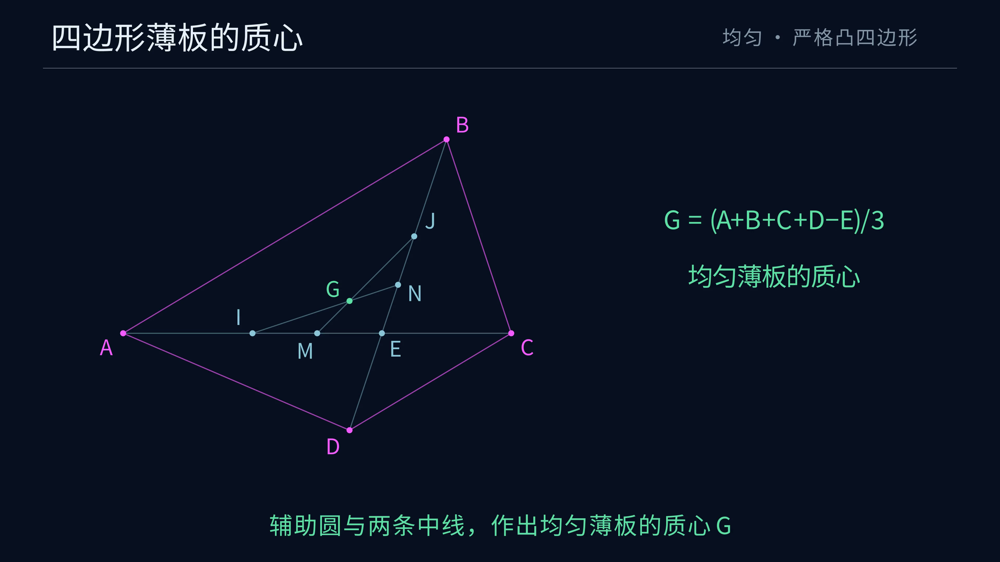

# 四边形薄板质心的构造与证明动画

[观看 4K60 MP4](https://raw.githubusercontent.com/lenovobenben/euclid-quadrilateral-centroid/main/animations/centroid/media/QuadrilateralCentroid_4k60.mp4)

动画 65.7 秒，3840 × 2160、60 fps。



## 展示内容

| 阶段 | 内容 |
|---|---|
| 给定与对角线 | 连接 $AC,BD$，取得内部交点 $E$ |
| 中点与辅助圆 | 作两条中垂线，取得 $M,N,F$，以 $F$ 为圆心经过 $E$ 作完整圆 |
| 交点与输出 | 取得另外两个圆交点 $I,J$，连接 $NI,MJ$，交于 $G$ |
| 面积加权 | 沿 $AC$ 分成两个三角形，展示面积比与两质心的加权平均 |
| 中线证明 | 放大三角形 $EIJ$，显示 $M,N$ 为两边中点，连接线为中线 |
| 顶点平均点 | 展示 $E,V,G$ 的次序及 $EV:VG=3:1$ |
| 特殊分支 | 一条对角线被平分时取三分之二，平行四边形直接取 $E$ |
| 完成图 | 回到原四边形与面积质心公式 |

主案例采用 $A=(-4,0)$、$B=(1,3)$、$C=(2,0)$、$D=(-1/2,-3/2)$。输出为 $G=(-1/2,1/2)$。[完整步骤与精确坐标](../../docs/ANSWER.md)

动画沿用深蓝背景 `#07101F` 与 Noto Sans CJK SC 字体。主构造的圆与四边形均为无填充细线。面积加权段用低透明度填色标明两块三角形，之后切换至放大的辅助三角形和共线比例图。

中垂线按文档中的经典尺规宏显示。特殊分支动画标明结果位置，完整三等分作法保存在 [ANSWER](../../docs/ANSWER.md)。

## 精确数据与检查

[export_geometry.py](export_geometry.py) 在 SageMath 10.7 中使用 `AA` 精确求交。主分支通过圆方程取得 $I,J$，再求两条连接线的交点。特殊分支实际求取等距点和最终平行线交点。

独立核验使用多边形边界一阶矩公式，另检查一般质心公式、内部位置及相似变换协变性。所有动画案例均通过同一个核验入口。

| 检查 | 实际结果 |
|---|---|
| 一般多项式恒等式 | 3 项通过 |
| 辅助圆主分支 | 203 次通过 |
| $M=E$ 分支 | 53 次通过 |
| $N=E$ 分支 | 53 次通过 |
| 平行四边形 | 52 次通过 |
| 非法输入 | 5 项按接口约定拒绝 |
| 动画显示回归 | 3 组通过 |

精确数据、显示坐标与核验计数写入 [geometry.json](geometry.json)，其摘要保存于 [geometry.sha256](geometry.sha256)。Manim 加载时核对数据与生成源码摘要。每次渲染在视频旁保存时间线、分辨率、帧率、场景源码摘要及几何数据摘要。

[test_centroid.py](test_centroid.py) 检查辅助圆在整个过程中保持无填充、圆完整处于绘图区内、显示交点的圆上关系、文字边界、点标签归属、仿射公式及分镜次序。

## 复现

以下命令均在项目根目录执行。

生成并核验精确数据

```powershell
docker run --rm --network none -e PYTHONDONTWRITEBYTECODE=1 -e OPENBLAS_NUM_THREADS=1 -v "${PWD}:/workspace" -w /workspace sagemath/sagemath@sha256:4f5589eb6c565949a006f8665de2876b8414410daf5ac554f4434a15d4f3d528 sage -python animations/centroid/export_geometry.py
```

沿用系列的 Manim Community 0.21.0 镜像。需要重建时执行

```powershell
docker build -t euclid-min-manim:0.21.0 animations/centroid
```

运行显示回归并渲染 4K60 成片

```powershell
docker run --rm --network none -e PYTHONDONTWRITEBYTECODE=1 -v "${PWD}:/manim" -w /manim euclid-min-manim:0.21.0 python -m unittest discover -s animations/centroid -p 'test_*.py' -v
docker run --rm --network none -e PYTHONDONTWRITEBYTECODE=1 -v "${PWD}:/manim" -w /manim euclid-min-manim:0.21.0 manim --config_file animations/centroid/manim.cfg -o QuadrilateralCentroid_4k60.mp4 animations/centroid/centroid.py QuadrilateralCentroid
```

预览渲染增加 `-r 1280,720 --fps 30`，并将输出名改为 `QuadrilateralCentroid_720p30.mp4`。

将成片转为索引前置的播放副本，复制时间线并提取预览图

```powershell
ffmpeg -y -i animations/centroid/media/videos/centroid/2160p60/QuadrilateralCentroid_4k60.mp4 -c copy -movflags +faststart animations/centroid/media/QuadrilateralCentroid_4k60.mp4
Copy-Item -LiteralPath animations/centroid/media/videos/centroid/2160p60/QuadrilateralCentroid_4k60.timeline.json -Destination animations/centroid/media/QuadrilateralCentroid_4k60.timeline.json
ffmpeg -y -sseof -2 -i animations/centroid/media/QuadrilateralCentroid_4k60.mp4 -frames:v 1 -update 1 animations/centroid/preview.png
```
